# POKERM NX by RyutaToki

> Antes se llamaba *PokéRando NX*.

Randomizer de ROMs de Pokémon que funciona en la propia Nintendo Switch (homebrew `.nro` para Atmosphère). Eliges la ROM de tu SD, ajustas las opciones con el mando o la pantalla táctil y la app crea una ROM nueva randomizada junto a la original. No hace falta ordenador.

Es un port a C++ de [Universal Pokemon Randomizer FVX](https://github.com/upr-fvx/universal-pokemon-randomizer-fvx): con la misma ROM, la misma semilla y las mismas opciones, el resultado es idéntico byte a byte al de FVX en el PC.


## Sobre este proyecto

No soy programador. Me gusta jugar randomlockes de Pokémon y quería poder prepararlos directamente en la Switch, sin tener que pasar cada vez por el ordenador para randomizar la ROM y copiarla a la consola.

Los randomizers que existen funcionan en el PC, así que, con mi suscripción a Claude (el asistente de IA de Anthropic), le fui pidiendo lo que necesitaba: una app para la Switch, en español, que se maneje solo con el mando y que haga lo mismo que el randomizer del PC.

El código lo ha escrito Claude siguiendo mis indicaciones, y yo lo he probado en mi propia consola. Lo comparto por si a alguien más le sirve. Si encuentras un fallo o sabes cómo mejorarlo, abre una incidencia o propón cambios: todo lo útil es bienvenido, pero ten en cuenta que no soy un desarrollador y puede que tarde en entender algunas cosas.

Todo el mérito de la lógica del randomizer es de [Universal Pokemon Randomizer](https://github.com/Dabomstew/universal-pokemon-randomizer) (Dabomstew), [UPR ZX](https://github.com/Ajarmar/universal-pokemon-randomizer-zx) (Ajarmar) y [UPR FVX](https://github.com/upr-fvx/universal-pokemon-randomizer-fvx) (foxoftheasterisk, voliol y colaboradores). Esta app es un port de su trabajo con una interfaz pensada para la Switch.

## Juegos compatibles

| Generación | Juegos | Estado |
|---|---|---|
| 3.ª (GBA) | Esmeralda, Rubí, Zafiro, Rojo Fuego, Verde Hoja | ✅ Compatibles (probado sobre todo con Esmeralda) |
| 4.ª (DS) | Diamante, Perla, Platino, HeartGold, SoulSilver | ✅ Compatibles (resultado idéntico a FVX en Platino, HeartGold y SoulSilver) |
| 5.ª (DS) | Negro, Blanco, Negro 2, Blanco 2 | ✅ Compatibles (resultado idéntico a FVX en Blanco y Negro 2) |

Desde la versión 0.2 funcionan también los juegos de DS de 4.ª y 5.ª generación. Las pestañas de opciones se adaptan a cada juego, y Extras incluye opciones propias de DS (correr sin Deportivas, barras de PS rápidas, Modo Desafío siempre activo…).

Se admiten las mismas versiones e idiomas que en FVX (español, inglés, francés, alemán, italiano y japonés). Las ROMs modificadas o hacks pueden no funcionar bien.

## Qué hace

- **Todas las opciones de FVX** para Gen 3, 4 y 5, organizadas en pestañas (más abajo se explica cada una).
- **Presets de serie** para no tener que mirar todos los ajustes: *Randomlocke básico*, *Randomlocke completo*, *Randomlocke difícil*, *Caos total*, *Solo salvajes* y *Kaizo*. También puedes guardar los tuyos.
- **Compatible con las settings strings de FVX**: puedes pegar la cadena de opciones del randomizer del PC.
- **Probabilidad de shiny** ajustable (de 1/8192 a 1/8), exclusivo de esta app. Por ahora solo en Esmeralda.
- **Log de spoilers** en español, que se puede leer desde la propia app.
- **No modifica nunca la ROM original.** La randomizada se guarda en la misma carpeta. Por defecto se borra la anterior de ese juego para no acumular archivos; en Ajustes puedes elegir conservarlas.

## Instalación

1. Necesitas una Switch con [Atmosphère](https://github.com/Atmosphere-NX/Atmosphere).
2. Descarga `pokermnx.nro` de la sección [Releases](../../releases) y cópialo a la SD en `switch/pokermnx/pokermnx.nro`. Si tenías la versión antigua, puedes borrar la carpeta `switch/pokerandonx/`: la app copia tus ajustes, presets e historial la primera vez que se abre.
3. Copia tus ROMs `.gba` o `.nds` a cualquier carpeta de la SD (por ejemplo `roms/gba/`).
4. Abre la app desde el Homebrew Menu (o TICO u otro lanzador). Mejor entrando manteniendo **R** al lanzar un juego, para que la app tenga toda la memoria.

La app guarda su configuración, presets e historial en `switch/pokermnx/`.

**La app no incluye, no descarga ni enlaza ROMs.** Solo trabaja con las que tengas en tu SD.

## Cómo se usa

### Controles

Todo se hace con el mando, y la pantalla táctil también funciona en todos los elementos.

| Botón | Qué hace |
|---|---|
| **Cruceta / stick** | Moverse entre opciones. En las barras de nivel, ◀ ▶ cambian el valor |
| **A** | Elegir, abrir o activar/desactivar |
| **B** | Volver atrás |
| **L / R** | Cambiar de pestaña en Opciones |
| **+** | Randomizar (en Opciones) o salir (en Inicio) |
| **−** | Menú rápido en Opciones; borrar en las listas |
| **X / Y** | Acciones extra de cada pantalla (aparecen siempre abajo a la derecha) |

### Inicio


- **Abrir ROM**: abre el explorador para elegir el juego y después sus opciones.
- **Presets guardados**: elige un preset y después la ROM; las opciones se abren con el preset ya aplicado.
- **ROMs generadas**: historial de todo lo que has randomizado.
- **Ajustes**: configuración de la app.
- A la derecha aparecen las tres últimas ROMs generadas. Pulsa sobre una para ver dónde está y abrir su log.
- Arriba a la derecha se ve el espacio libre de la SD.

### Elegir ROM

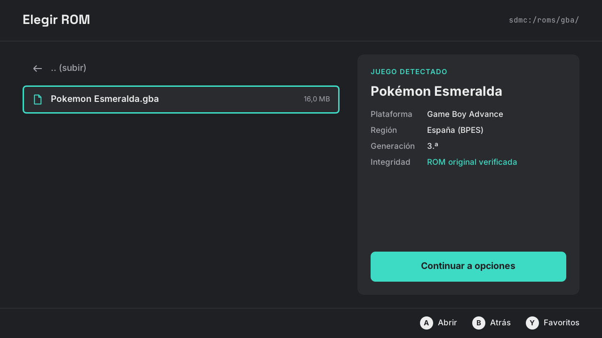

Recorre las carpetas de la SD. Al pasar por una ROM, el panel de la derecha muestra qué juego es, su región y si es una **ROM original verificada** o una **modificada o hack** (en ese caso puede no funcionar bien). Los archivos que no son `.gba` ni `.nds` salen atenuados, o se ocultan si lo eliges en Ajustes.

- **A**: entrar en una carpeta o elegir la ROM.
- **Y**: marcar la carpeta como favorita; las favoritas salen siempre arriba.
- La próxima vez se abre en la última carpeta que usaste.

### Opciones

Es la pantalla principal: a la izquierda las pestañas y a la derecha las opciones de cada una. Arriba se ven el **preset** cargado (pasa a «Personalizado» en cuanto cambias algo) y la **semilla**.

- **L / R**: pestaña anterior o siguiente.
- **A**: cambiar la opción con el foco.
- **Y**: escribir una semilla concreta. Con la misma ROM, semilla y opciones, el resultado es siempre el mismo (y el mismo que en FVX en el PC).
- **X**: guardar las opciones actuales como preset.
- **−**: menú rápido: cargar preset, restablecer la pestaña, restablecer todo o pegar una settings string de FVX.
- **+**: randomizar.

Cuando una opción depende de otra (por ejemplo, «Fuerza similar» solo tiene sentido si los salvajes se randomizan), sale atenuada y el foco se la salta. Las opciones que no existen en el juego cargado no aparecen.

Cada opción, pestaña a pestaña:

<details>
<summary><b>Pokémon base</b></summary>

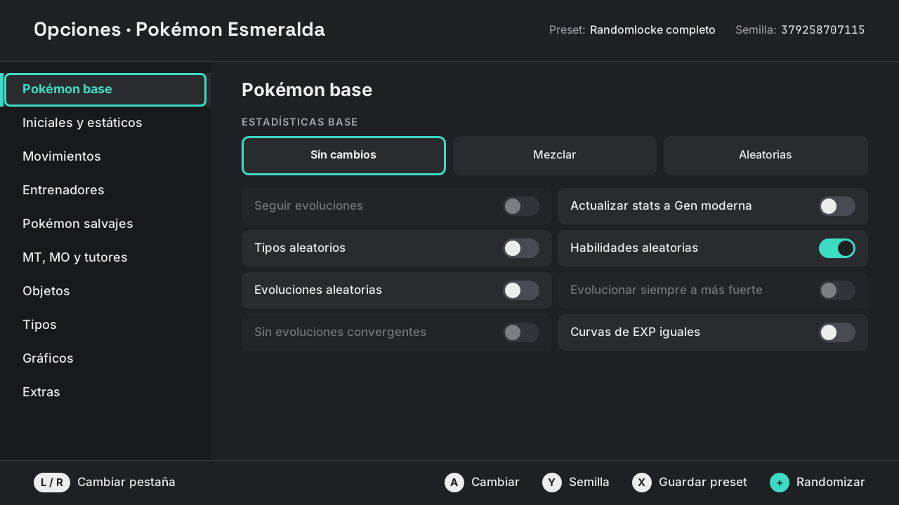

- **Estadísticas base**: *Sin cambios*, *Mezclar* (cada Pokémon intercambia entre sí sus propias estadísticas, por ejemplo el Ataque con el Ataque Especial) o *Aleatorias* (estadísticas nuevas repartiendo el mismo total que tenía).
- **Seguir evoluciones**: las evoluciones conservan un reparto parecido al de su forma anterior.
- **Actualizar stats a Gen moderna**: aplica los cambios de estadísticas de las generaciones posteriores, hasta la 9.ª.
- **Tipos aleatorios**: cada Pokémon tiene tipos nuevos (sus evoluciones los siguen).
- **Habilidades aleatorias**: habilidades nuevas, iguales en toda la familia de evolución.
- **Evoluciones aleatorias**: cada Pokémon evoluciona en otro distinto.
  - **Evolucionar siempre a más fuerte**: la evolución siempre tiene más estadísticas totales.
  - **Sin evoluciones convergentes**: dos Pokémon nunca evolucionan en el mismo.
- **Curvas de EXP iguales**: todos los Pokémon suben de nivel al mismo ritmo.
</details>

<details>
<summary><b>Iniciales y estáticos</b></summary>

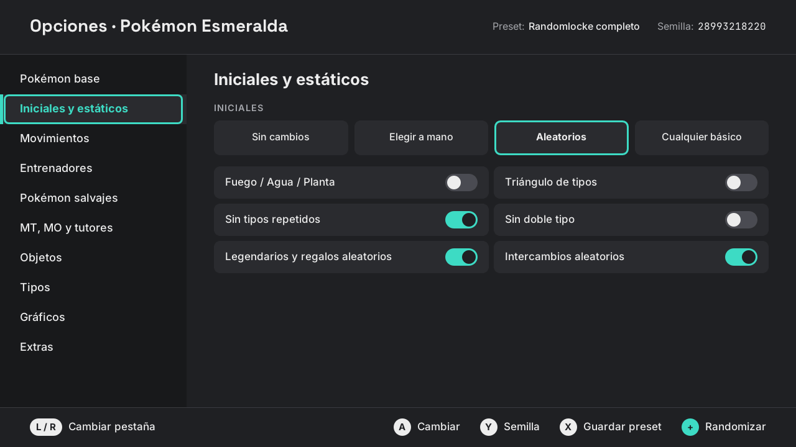

- **Iniciales**: *Sin cambios*, *Elegir a mano* (abre una lista para escoger los tres), *Aleatorios* o *Cualquier básico* (Pokémon sin preevolución).
- **Fuego / Agua / Planta**, **Triángulo de tipos** (cada uno es fuerte contra el siguiente) y **Sin tipos repetidos**: restricciones de tipo para los iniciales aleatorios (solo una a la vez).
- **Sin doble tipo**: los iniciales tienen un solo tipo.
- **Legendarios y regalos aleatorios**: cambia los Pokémon fijos del juego (legendarios, fósiles, regalos…): los legendarios por otros legendarios y el resto por Pokémon normales.
- **Intercambios aleatorios**: cambia tanto el Pokémon que te dan como el que te piden en los intercambios con personajes.

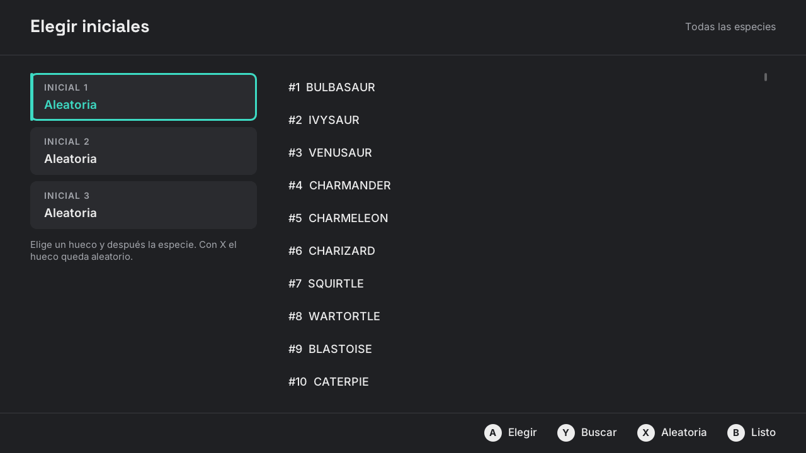

Con *Elegir a mano*: elige un hueco a la izquierda y después la especie. **Y** busca por nombre o número y **X** deja el hueco aleatorio.
</details>

<details>
<summary><b>Movimientos</b></summary>

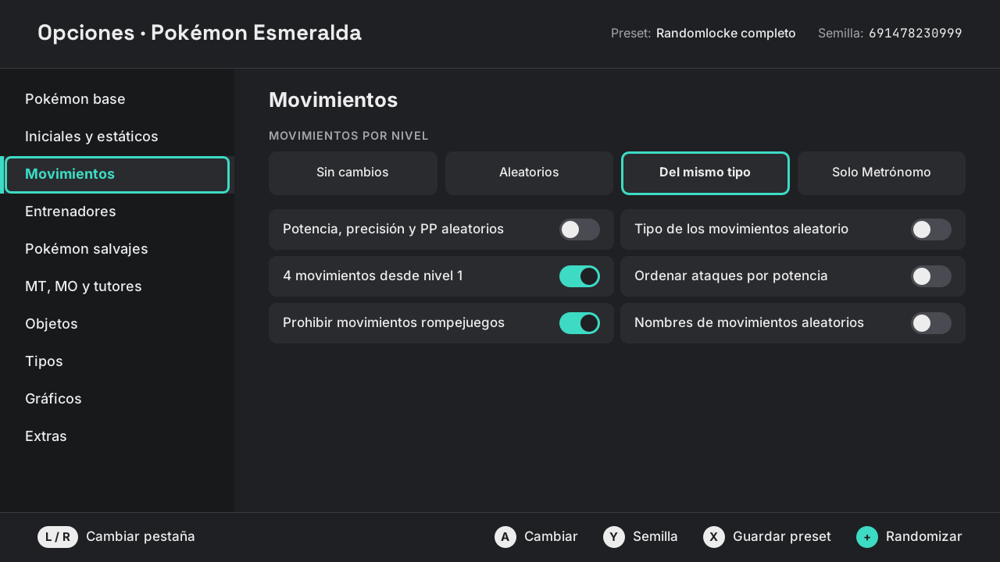

- **Movimientos por nivel**: *Sin cambios*, *Aleatorios*, *Del mismo tipo* (preferentemente del tipo del Pokémon) o *Solo Metrónomo*.
- **Potencia, precisión y PP aleatorios** y **Tipo de los movimientos aleatorio**: cambian los propios movimientos.
- **Categoría física/especial aleatoria**: solo en juegos que separan ataques físicos y especiales (4.ª generación en adelante).
- **4 movimientos desde nivel 1**: todos los Pokémon empiezan con cuatro ataques.
- **Ordenar ataques por potencia**: los ataques flojos se aprenden antes que los fuertes.
- **Prohibir movimientos rompejuegos**: evita movimientos como Bomba Sónica o Furia Dragón.
- **Nombres de movimientos aleatorios**.
</details>

<details>
<summary><b>Entrenadores</b></summary>

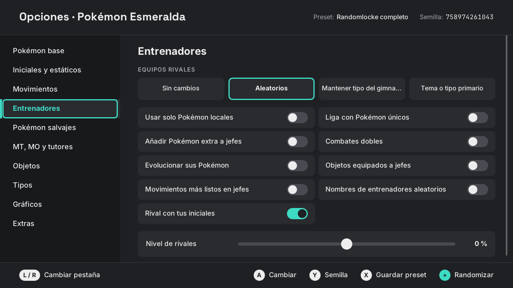

- **Equipos rivales**: *Sin cambios*, *Aleatorios*, *Mantener tipo del gimnasio* (los líderes y sus entrenadores siguen usando un tipo, aunque sea otro) o *Tema o tipo primario*.
- **Usar solo Pokémon locales**: los entrenadores usan Pokémon que se pueden encontrar en el juego.
- **Liga con Pokémon únicos**: cada miembro del Alto Mando lleva un Pokémon que no sale en ningún otro entrenador.
- **Añadir Pokémon extra a jefes**: líderes, rival y Alto Mando llevan un Pokémon más.
- **Combates dobles**: todos los combates contra entrenadores son dobles.
- **Evolucionar sus Pokémon**: los Pokémon rivales salen evolucionados según su nivel.
- **Objetos equipados a jefes** y **Movimientos más listos en jefes**: jefes mejor preparados.
- **Nombres de entrenadores aleatorios**.
- **Rival con tus iniciales**: el rival lleva siempre su inicial (evolucionada cuando toca).
- **Nivel de rivales**: sube o baja su nivel entre −50 % y +50 %.
</details>

<details>
<summary><b>Pokémon salvajes</b></summary>

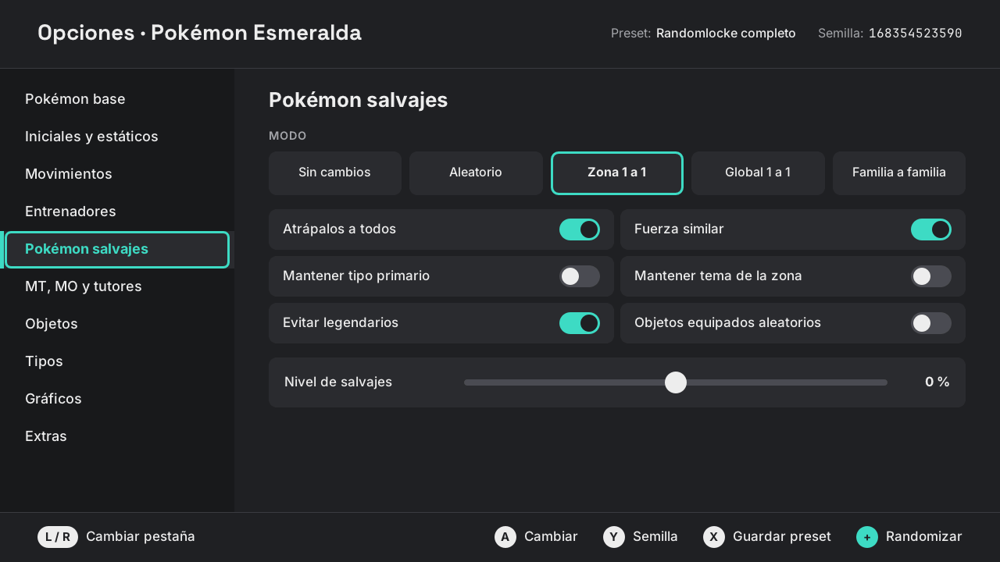

- **Modo**:
  - *Aleatorio*: cada hueco de cada zona recibe un Pokémon al azar, sin reglas.
  - *Zona 1 a 1*: dentro de cada zona, cada especie se cambia siempre por la misma.
  - *Global 1 a 1*: igual, pero en todo el juego (si Zigzagoon pasa a ser Gible, lo es en todas partes).
  - *Familia a familia*: como Global 1 a 1, pero por familias de evolución.
- **Atrápalos a todos**: intenta que salgan todas las especies antes de repetir (no en Global ni Familia).
- **Fuerza similar**: el sustituto tiene unas estadísticas totales parecidas al original.
- **Mantener tipo primario**: el sustituto comparte el tipo principal del original.
- **Mantener tema de la zona**: las zonas con un tipo dominante (cuevas, lagos…) siguen teniéndolo.
- **Evitar legendarios**.
- **Objetos equipados aleatorios**: los objetos que pueden llevar los salvajes.
- **Nivel de salvajes**: entre −50 % y +50 %.
</details>

<details>
<summary><b>MT, MO y tutores</b></summary>

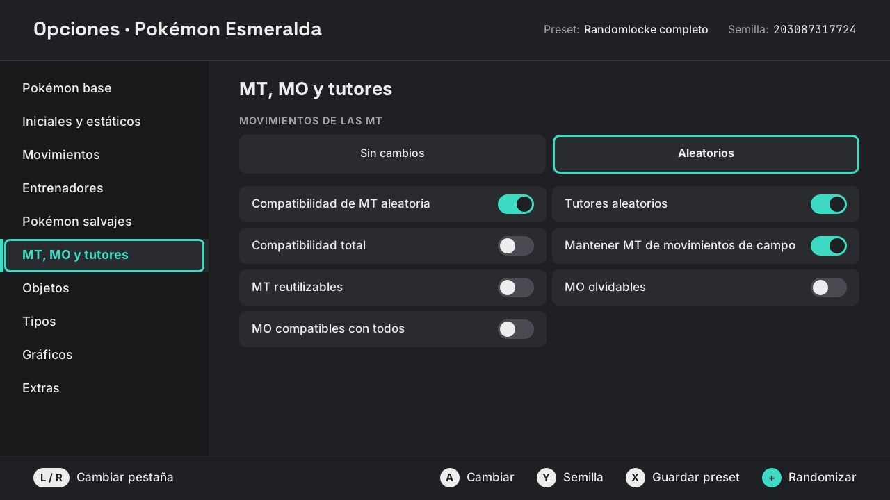

- **Movimientos de las MT**: *Sin cambios* o *Aleatorios*.
- **Compatibilidad de MT aleatoria**: qué Pokémon aprende cada MT y tutor (con preferencia por su tipo).
- **Tutores aleatorios**: los movimientos que enseñan los tutores.
- **Compatibilidad total**: todos los Pokémon aprenden todas las MT y tutores.
- **Mantener MT de movimientos de campo**: Corte, Surf… siguen siendo MT/MO aunque las MT sean aleatorias.
- **MT reutilizables** y **MO olvidables**: ajustes del juego (solo donde existen).
- **MO compatibles con todos**: cualquier Pokémon puede aprender todas las MO.
</details>

<details>
<summary><b>Objetos</b></summary>

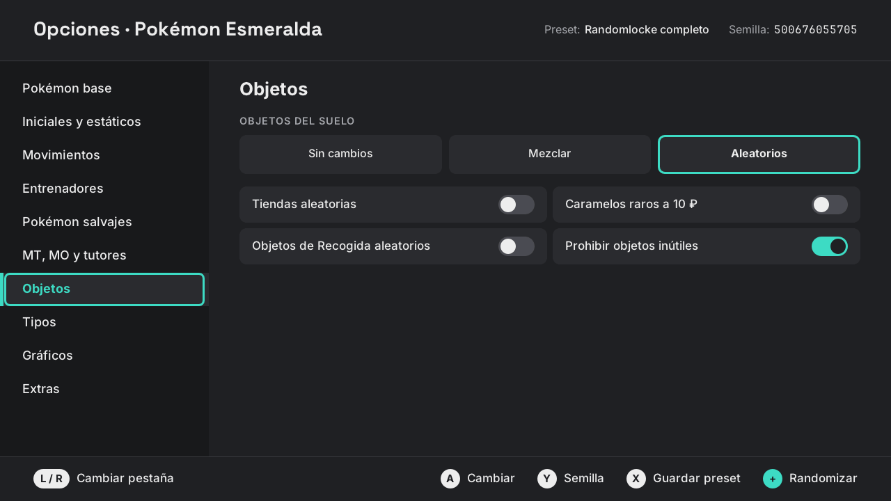

- **Objetos del suelo**: *Sin cambios*, *Mezclar* (los mismos objetos en otros sitios) o *Aleatorios*.
- **Tiendas aleatorias**.
- **Caramelos raros a 10 ₽**: añade Caramelos Raros baratos a las tiendas.
- **Objetos de Recogida aleatorios**.
- **Prohibir objetos inútiles**: evita objetos que no sirven para nada.
</details>

<details>
<summary><b>Tipos</b></summary>

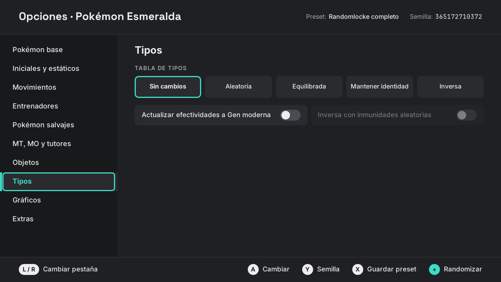

- **Tabla de tipos** (qué tipo es fuerte o débil contra cuál):
  - *Aleatoria*: con el mismo número total de debilidades, resistencias e inmunidades.
  - *Equilibrada*: aleatoria, pero ningún tipo queda más descompensado que el peor del juego original.
  - *Mantener identidad*: cada tipo conserva su número de debilidades y resistencias, pero contra otros tipos.
  - *Inversa*: como los combates inversos de 6.ª generación (las debilidades pasan a ser resistencias y al revés).
- **Actualizar efectividades a Gen moderna**: aplica los cambios de la tabla de generaciones posteriores.
- **Inversa con inmunidades aleatorias**: con la tabla inversa, algunas debilidades pasan a ser inmunidades.
</details>

<details>
<summary><b>Gráficos</b></summary>

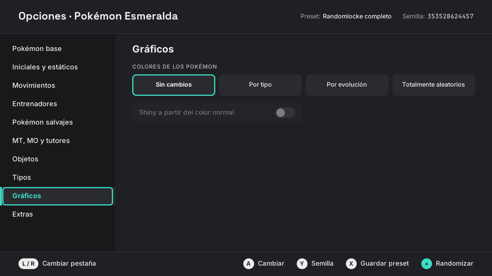

- **Colores de los Pokémon**: *Sin cambios*, *Por tipo* (un Pokémon de tipo Fuego tiende al rojo), *Por evolución* (las familias tienen colores parecidos) o *Totalmente aleatorios*.
- **Shiny a partir del color normal**: la versión shiny tiene los colores originales del Pokémon.
</details>

<details>
<summary><b>Extras</b> (exclusivo de esta app)</summary>

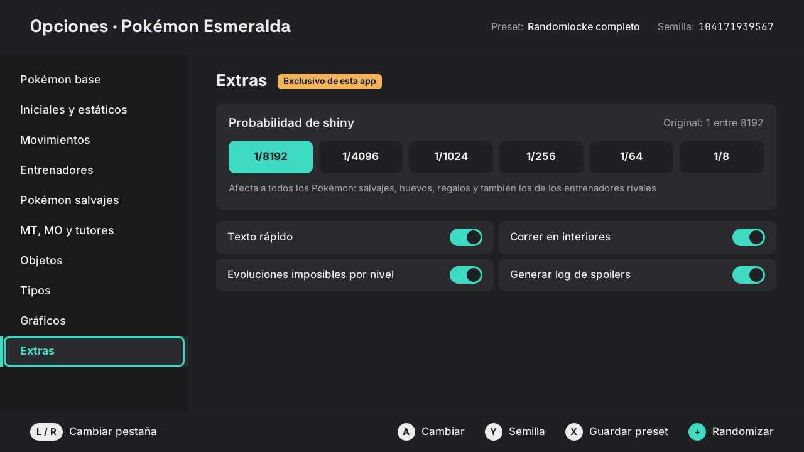

- **Probabilidad de shiny**: de 1/8192 (original) a 1/8. Afecta a todos los Pokémon, también a los de los entrenadores rivales. Por ahora solo en Esmeralda; en otros juegos aparece «No disponible».
- **Texto rápido** y **Correr en interiores**.
- **Evoluciones imposibles por nivel**: los Pokémon que evolucionan por intercambio pasan a evolucionar de otra forma, para que se puedan conseguir sin intercambiar.
- **Generar log de spoilers**: crea el archivo `.log.txt` con todos los cambios.
</details>

### Presets guardados


| Preset | Para qué |
|---|---|
| **Randomlocke básico** | Iniciales aleatorios con dos evoluciones y tipos distintos, salvajes zona 1 a 1 con fuerza similar y sin legendarios, entrenadores aleatorios con el rival llevando tu inicial, regalos e intercambios aleatorios, evoluciones posibles sin intercambio, texto rápido y correr en interiores. El juego sigue siendo reconocible. |
| **Randomlocke completo** | El básico más habilidades, movimientos, MT, tutores y objetos aleatorios, sin lo que rompe el juego. |
| **Randomlocke difícil** | El completo con rivales un 15 % más fuertes, evolucionados, y jefes con un Pokémon más, objetos y mejores movimientos. |
| **Caos total** | Todo aleatorio. |
| **Solo salvajes** | Solo cambian los Pokémon salvajes. |
| **Kaizo** | Rivales muchísimo más duros. |

- **A**: cargar. **X**: renombrar. **Y**: duplicar. **−**: borrar (los de serie no se pueden renombrar ni borrar).

### Randomizar

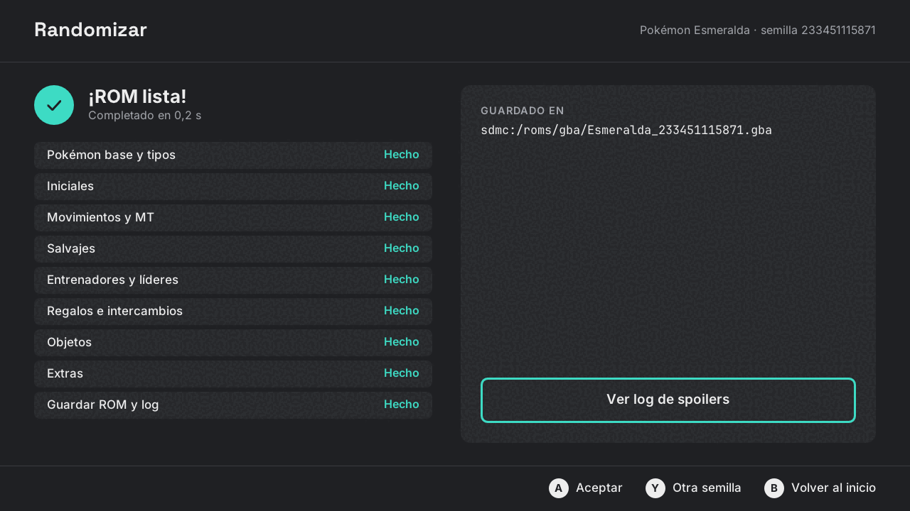

Al pulsar **+** la app muestra los pasos que va completando. No se puede cancelar a mitad, para no dejar una ROM estropeada. Al terminar indica dónde se ha guardado la ROM.

- La ROM nueva se llama `{Juego}_{semilla}.gba` (o `.nds`) y está en la **misma carpeta que la original**, junto a su log.
- **Y**: repetir con las mismas opciones y otra semilla.
- **B**: volver al inicio.
- **Ver log de spoilers** abre el log en la propia app:

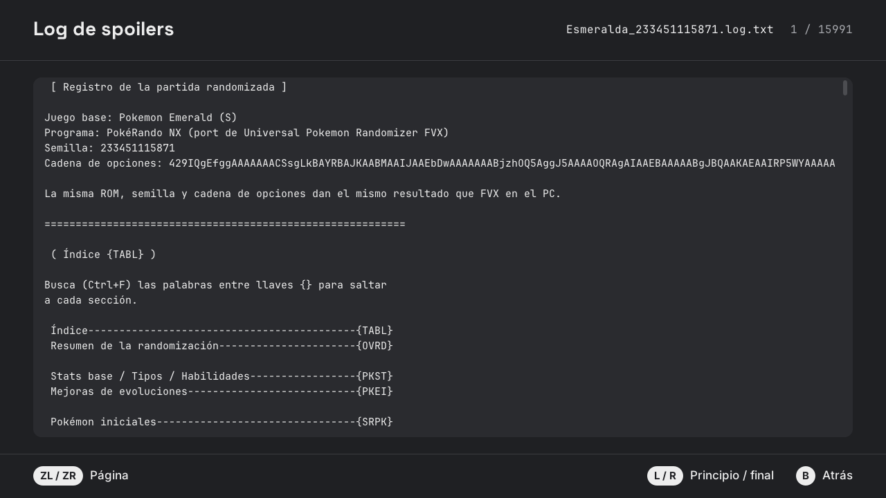

En el log, **↑ ↓** avanzan línea a línea, **ZL / ZR** pasan página, **L / R** van al principio o al final y **◀ ▶** desplazan en horizontal.

### ROMs generadas

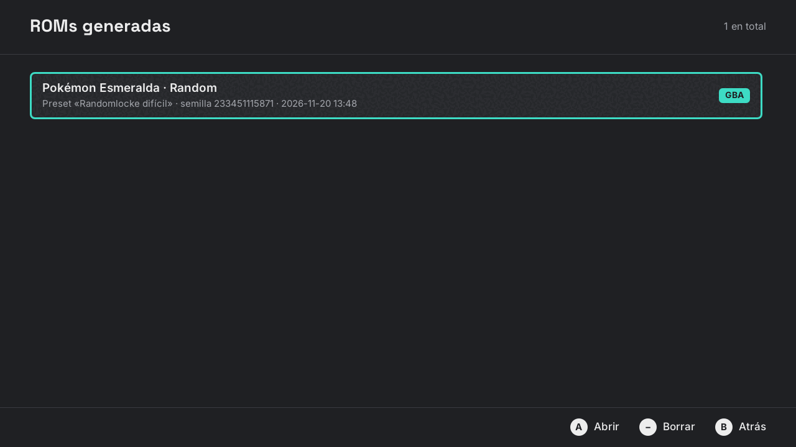

Historial de las ROMs creadas. **A** abre su ficha (ruta y log) y **−** la borra de la SD junto con su log.

### Ajustes

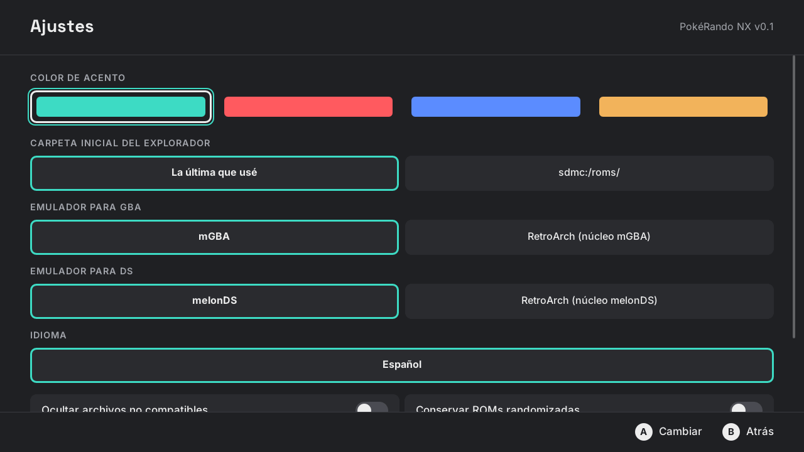

- **Color de acento**: turquesa, rojo, azul o ámbar.
- **Carpeta inicial del explorador**: la última que usaste o `sdmc:/roms/`.
- **Ocultar archivos no compatibles** en el explorador.
- **Conservar ROMs randomizadas**: por defecto, al randomizar se borra la ROM randomizada anterior de ese juego que haya en la carpeta (nunca la original). Actívalo si quieres guardarlas todas.
- **Acerca de**: créditos y licencia.

## Compilar

Hace falta [devkitPro](https://devkitpro.org/) con devkitA64 y los paquetes de Switch (`switch-dev`, `switch-glfw`, `switch-mesa`, `switch-glm`), CMake y Ninja.

```sh
git clone --recursive https://github.com/RyutaToki/pokerm-nx.git
cd pokerm-nx
# .nro para la Switch
cmake -S . -B build-nx -G Ninja -DPR_BUILD_APP=ON -DPR_BUILD_CLI=OFF -DPLATFORM_SWITCH=ON -DCMAKE_BUILD_TYPE=Release
cmake --build build-nx        # -> build-nx/app/pokermnx.nro
# versión de escritorio (Linux) para probar la interfaz
cmake -S . -B build-app -G Ninja -DPR_BUILD_APP=ON -DPR_BUILD_CLI=OFF -DPLATFORM_DESKTOP=ON
cmake --build build-app
```

Estructura:

- `core/`: núcleo del randomizer en C++ puro, sin interfaz (lectura y escritura de ROMs, randomizers, opciones, log y datos)
- `app/`: interfaz con [Borealis](https://github.com/xfangfang/borealis) (Switch y Linux)
- `cli/`: programa de línea de comandos para probar el núcleo en Linux
- `tests/`: comparaciones con FVX para comprobar que el resultado es idéntico

## Licencia

GPLv3, heredada de Universal Pokemon Randomizer FVX. Los datos de `core/data/` (offsets, tablas de texto y parches) provienen de FVX. Fuentes Inter, Space Grotesk y JetBrains Mono con licencia OFL.

Pokémon es una marca de Nintendo, Game Freak y The Pokémon Company. Este proyecto no está afiliado ni respaldado por ellas, y no usa sus logotipos ni su material gráfico.
