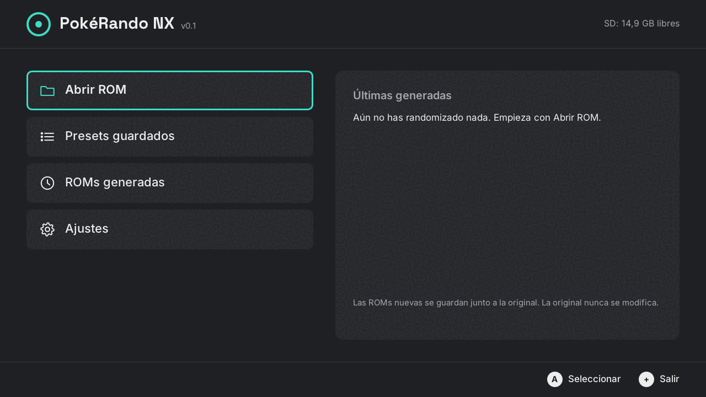
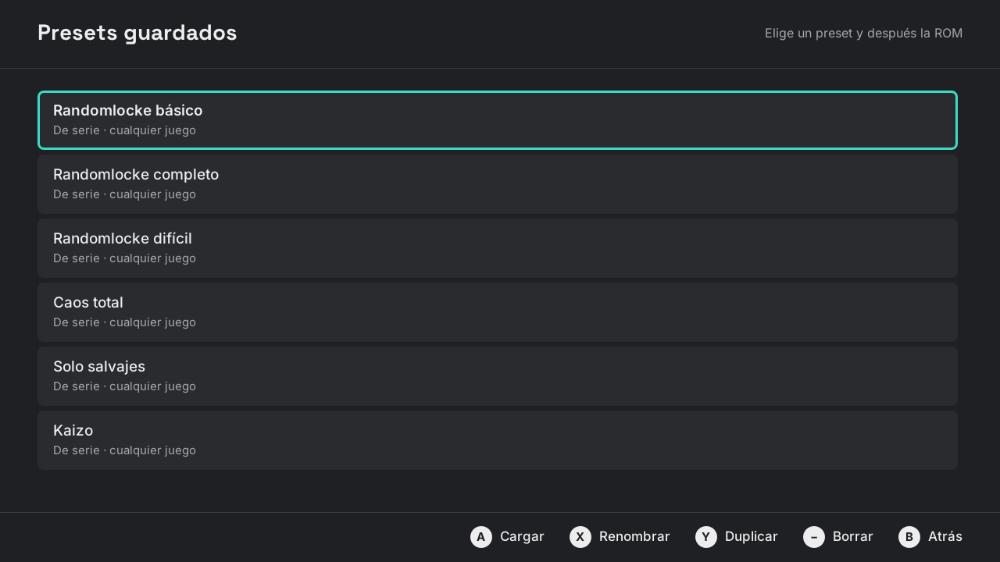
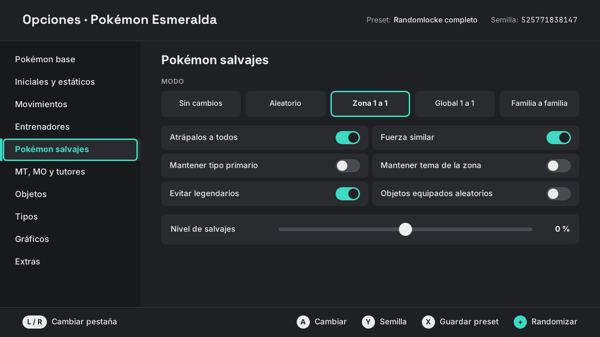
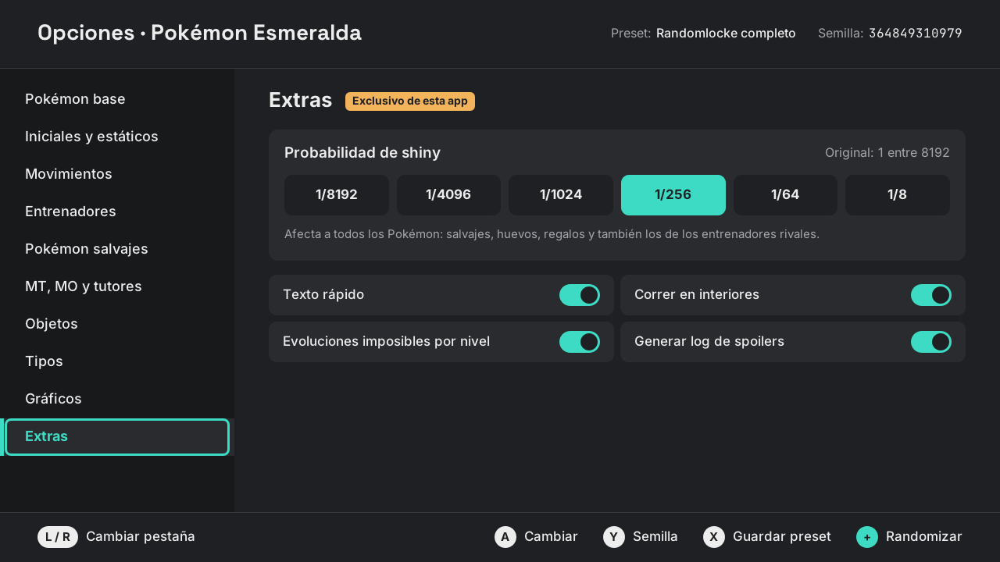

# PokéRando NX

Randomizer de ROMs de Pokémon que funciona en la propia Nintendo Switch (homebrew `.nro` para Atmosphère). Eliges la ROM de tu SD, ajustas las opciones con el mando o la pantalla táctil y la app crea una ROM nueva randomizada junto a la original. No hace falta ordenador.

Es un port a C++ de [Universal Pokemon Randomizer FVX](https://github.com/upr-fvx/universal-pokemon-randomizer-fvx): con la misma ROM, la misma semilla y las mismas opciones, el resultado es idéntico byte a byte al de FVX en el PC.



## Sobre este proyecto

No soy programador. Me gusta jugar randomlockes de Pokémon y quería poder prepararlos directamente en la Switch, sin tener que pasar cada vez por el ordenador para randomizar la ROM y copiarla a la consola.

Los randomizers que existen funcionan en el PC, así que, con mi suscripción a Claude (el asistente de IA de Anthropic), le fui pidiendo lo que necesitaba: una app para la Switch, en español, que se maneje solo con el mando y que haga lo mismo que el randomizer del PC.

El código lo ha escrito Claude siguiendo mis indicaciones, y yo lo he probado en mi propia consola. Lo comparto por si a alguien más le sirve. Si encuentras un fallo o sabes cómo mejorarlo, abre una incidencia o propón cambios: todo lo útil es bienvenido, pero ten en cuenta que no soy un desarrollador y puede que tarde en entender algunas cosas.

Todo el mérito de la lógica del randomizer es de [Universal Pokemon Randomizer](https://github.com/Dabomstew/universal-pokemon-randomizer) (Dabomstew), [UPR ZX](https://github.com/Ajarmar/universal-pokemon-randomizer-zx) (Ajarmar) y [UPR FVX](https://github.com/upr-fvx/universal-pokemon-randomizer-fvx) (foxoftheasterisk, voliol y colaboradores). Esta app es un port de su trabajo con una interfaz pensada para la Switch.

## Juegos compatibles

| Generación | Juegos | Estado |
|---|---|---|
| 3.ª (GBA) | Esmeralda, Rubí, Zafiro, Rojo Fuego, Verde Hoja | ✅ Compatibles (probado sobre todo con Esmeralda) |
| 4.ª (DS) | Diamante, Perla, Platino, HeartGold, SoulSilver | 🚧 En preparación |
| 5.ª (DS) | Negro, Blanco, Negro 2, Blanco 2 | 🚧 En preparación |

**Estoy empezando a trabajar para añadir compatibilidad con más juegos de Pokémon.** Por ahora solo funcionan los de GBA; los de DS llegarán en próximas versiones.

Se admiten las mismas versiones e idiomas que en FVX (español, inglés, francés, alemán, italiano y japonés). Las ROMs modificadas o hacks pueden no funcionar bien.

## Qué hace

- **Todas las opciones de FVX** para Gen 3, organizadas en pestañas: Pokémon base, iniciales y estáticos, movimientos, entrenadores, salvajes, MT y tutores, objetos, tipos, gráficos y extras.
- **Presets de serie** para no tener que mirar todos los ajustes: *Randomlocke básico*, *Randomlocke completo*, *Randomlocke difícil*, *Caos total*, *Solo salvajes* y *Kaizo*. También puedes guardar los tuyos.
- **Compatible con las settings strings de FVX**: puedes pegar la cadena de opciones del randomizer del PC.
- **Probabilidad de shiny** ajustable (de 1/8192 a 1/8), exclusivo de esta app. Por ahora solo en Esmeralda.
- **Log de spoilers** en español, que se puede leer desde la propia app.
- **No modifica nunca la ROM original.** La randomizada se guarda en la misma carpeta. Por defecto se borra la anterior de ese juego para no acumular archivos; en Ajustes puedes elegir conservarlas.

| | |
|---|---|
|  |  |
|  | |

## Instalación

1. Necesitas una Switch con [Atmosphère](https://github.com/Atmosphere-NX/Atmosphere).
2. Descarga `pokerandonx.nro` de la sección [Releases](../../releases) y cópialo a la SD en `switch/pokerandonx/pokerandonx.nro`.
3. Copia tus ROMs `.gba` a cualquier carpeta de la SD (por ejemplo `roms/gba/`).
4. Abre la app desde el Homebrew Menu (o TICO u otro lanzador). Mejor entrando manteniendo **R** al lanzar un juego, para que la app tenga toda la memoria.

La app guarda su configuración, presets e historial en `switch/pokerandonx/`.

**La app no incluye, no descarga ni enlaza ROMs.** Solo trabaja con las que tengas en tu SD.

## Compilar

Hace falta [devkitPro](https://devkitpro.org/) con devkitA64 y los paquetes de Switch (`switch-dev`, `switch-glfw`, `switch-mesa`, `switch-glm`), CMake y Ninja.

```sh
git clone --recursive https://github.com/RyutaToki/pokerando-nx.git
cd pokerando-nx
# .nro para la Switch
cmake -S . -B build-nx -G Ninja -DPR_BUILD_APP=ON -DPR_BUILD_CLI=OFF -DPLATFORM_SWITCH=ON -DCMAKE_BUILD_TYPE=Release
cmake --build build-nx        # -> build-nx/app/pokerandonx.nro
# versión de escritorio (Linux) para probar la interfaz
cmake -S . -B build-app -G Ninja -DPR_BUILD_APP=ON -DPR_BUILD_CLI=OFF -DPLATFORM_DESKTOP=ON
cmake --build build-app
```

Estructura:

- `core/`: núcleo del randomizer en C++ puro, sin interfaz (lectura y escritura de ROMs, randomizers, opciones, log y datos)
- `app/`: interfaz con [Borealis](https://github.com/xfangfang/borealis) (Switch y Linux)
- `cli/`: programa de línea de comandos para probar el núcleo en Linux
- `tests/`: comparaciones con FVX para comprobar que el resultado es idéntico

## Licencia

GPLv3, heredada de Universal Pokemon Randomizer FVX. Los datos de `core/data/` (offsets, tablas de texto y parches) provienen de FVX. Fuentes Inter, Space Grotesk y JetBrains Mono con licencia OFL.

Pokémon es una marca de Nintendo, Game Freak y The Pokémon Company. Este proyecto no está afiliado ni respaldado por ellas, y no usa sus logotipos ni su material gráfico.
